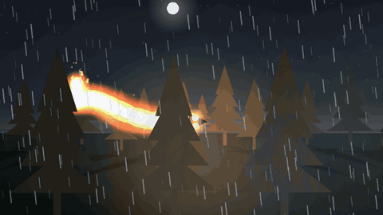

# Boitatá

<!-- logo and banner go here once the art exists: see docs/design/boitata-style-guide.md -->

**Light, shadows, weather and fire for 2D scenes in Kotlin Multiplatform.** One Compose Multiplatform library for Android, iOS, desktop and web (Wasm).


Named after the **Boitatá** (*mboi tatá*, "fire snake"), the giant serpent of flame from Tupi-Guarani folklore: a guardian of the forest whose fire lights the dark and never burns the living plants.

> **Status: 0.x, not published yet.** The API will change. Boitatá was extracted from [The Typist](https://thetypist.app), where it lights a noir desk.

## What you get

Everything is drawn on a plain Compose canvas (no shaders, no platform code), so it looks the same on every target. Fire, rain, snow and fog are pure functions of time: give them
the same `seconds` and you get the same frame, so you can scrub them, pause them, or record them.

### Fire that lights what is near it


```kotlin
@Composable
fun MinimalFire() {
    val seconds = rememberSkySeconds()
    Box(Modifier.fillMaxSize().background(Color(0xFF06080C))) {
        Fire(seconds, Modifier.align(Alignment.Center).size(260.dp), intensity = 0.9f, palette = FlamePalette.Boitata)
    }
}
```

`FlamePalette.Campfire`, `.Boitata` and `.Blue` are built in. `fireLight(...)` gives you the matching flickering `LightSource`, and `drawFlameTrail(...)` draws fire along a path, which is how the serpent above is made.


### Shadows that swing round as the light moves


```kotlin
@Composable
fun MinimalShadow() {
    val lamp = LightSource(x = 200f, y = 120f, color = Color(0xFFFFD08A), strength = 0.9f, reach = 700f, groundX = 200f, groundY = 360f)
    Box(Modifier.fillMaxSize().background(Color(0xFF14110D))) {
        CastShadow(lamp, feetX = 520f, feetY = 380f, height = 160f) { color ->
            // Feet at (0, 0), up is negative y; `color` is the shadow's colour when it is drawn as a shadow.
            drawRect(color, Offset(-8f, -160f), Size(16f, 160f))
        }
    }
}
```

Anything you can draw with a `DrawScope` can cast a shadow. The shadow leans away from the light and is longer the nearer the light is.

### Sunlight through a window, following the hour


```kotlin
@Composable
fun MinimalWindowLight() {
    val seconds = rememberSkySeconds()
    val sky = SkyModel.at(hour = 17f, SkyWeather.Clear)
    Box(Modifier.fillMaxSize().background(Color(0xFF3A2F26))) {
        WindowLight(
            window = Rect(80f, 60f, 330f, 320f), floorY = 380f, depth = 160f, lean = 0.9f,
            color = sky.lightColor, strength = sky.lightStrength, elevation = sky.sunElevation, seconds = seconds,
        )
    }
}
```

`SkyModel.at(hour, weather)` is pure maths (no drawing, no clock): where the sun and moon are, how bright the day is, what colour the light is. The patch is one band per row of panes, so the frame's bars show as dark lines.

### Weather that follows the hour



```kotlin
@Composable
fun MinimalRain() {
    val seconds = rememberSkySeconds()
    Box(Modifier.fillMaxSize().background(Color(0xFF0B1220))) {
        Rain(seconds, intensity = 0.8f, wind = 0.3f)
    }
}
```

`Rain`, `Snow` and `Fog` are the same shape of call. `SkyWindow` draws a whole sky (sun, moon, stars, clouds) with parallax layers and lightning from `rememberStorm`.

All of these snippets are in [Minimal.kt](samples/playground/src/commonMain/kotlin/br/com/faru/boitata/playground/Minimal.kt) and are compiled with the rest of the project.

## Try the playground

A demo app with live controls (hour, weather, light position, fire size) for every feature above.

```bash
# desktop
./gradlew :samples:playground-desktop:run

# web (opens in your browser)
./gradlew :samples:playground-web:wasmJsBrowserDevelopmentRun
```

Android and iOS shells for the playground are not there yet; the playground code itself is shared (`samples/playground`), so they are thin.

The GIFs in this README are drawn offscreen by the same code, frame by frame, so they are the same on every machine: `./docs/media/render.sh` regenerates them (needs `ffmpeg`).

## Modules

| Module | What it gives | Depends on |
|---|---|---|
| `boitata-core` | Pure maths and models, nothing drawn: `Perspective`, `FastNoise`, `SkyModel`, `StormModel`, time cycles, window-light geometry | Compose graphics types only |
| `boitata-scene` | `SceneCamera`, `SceneViewport` (fits a world to any window), `Modifier.worldBounds` | core |
| `boitata-light` | `LightSource`, `LightShade`, `Fire`, `drawFlameTrail`, `CastShadow`, `CastSilhouette`, `WindowLight`, flicker | core, scene |
| `boitata-weather` | `Rain`, `Snow`, `Fog`, `SkyWindow`, `rememberStorm` (lightning) | core |

See [docs/architecture.md](docs/architecture.md) for how they fit together.

## Use it (once published)

```kotlin
// build.gradle.kts of your KMP module
commonMain.dependencies {
    implementation("br.com.faru.boitata:boitata-light:<version>")
    implementation("br.com.faru.boitata:boitata-weather:<version>")
}
```

Until then, include it as a composite build: `includeBuild("../boitata")` in your `settings.gradle.kts`, and depend on `br.com.faru.boitata:boitata-light:0.1.0-SNAPSHOT`. That is how The Typist uses it today.

## Build

```bash
./gradlew build
```

Needs JDK 21 and an Android SDK (`sdk.dir` in `local.properties`). Targets: Android, iOS (arm64 and simulator), JVM, wasmJs.

## Where the name comes from

The Boitatá belongs to the Indigenous peoples of Brazil first: it is a figure of Tupi-Guarani folklore, written down by the Jesuit José de Anchieta in the 1560s. The library borrows
the name for what the serpent does: it is made of light, it guards the dark, and its fire shows the forest without burning it. The art direction is in
[docs/design/boitata-style-guide.md](docs/design/boitata-style-guide.md).

## Licence

[Apache-2.0](LICENSE). The licence covers the code, not the Boitatá name or logo.
