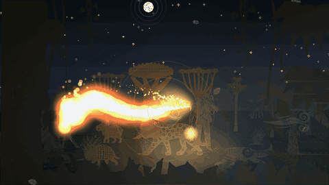
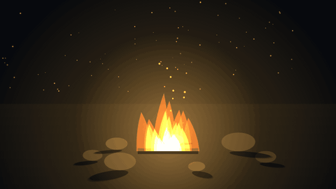
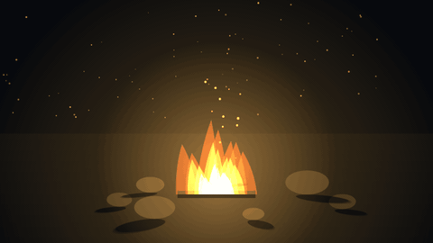
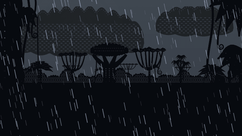
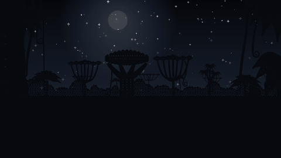
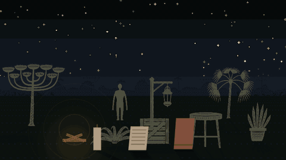
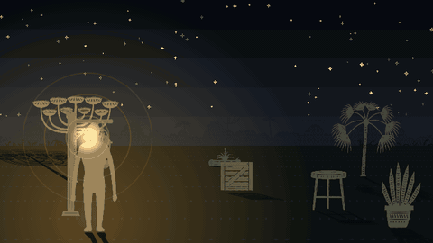
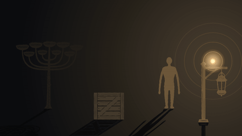
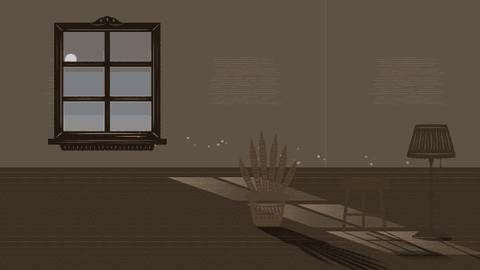
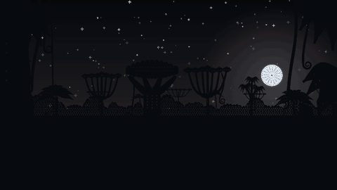

# Boitatá

<!-- logo and banner go here once the art exists: see docs/design/boitata-style-guide.md -->

**Light, shadows, weather and fire for 2D scenes in Kotlin Multiplatform.** One Compose Multiplatform library for Android, iOS, desktop and web (Wasm).



Named after the **Boitatá** (*mboi tatá*, "fire snake"), the giant serpent of flame from Tupi-Guarani folklore: a guardian of the forest whose fire lights the dark and never burns the living plants.

> **Status: 0.x, not published yet.** The API will change. Boitatá was extracted from [The Typist](https://thetypist.app), where it lights a noir desk.

## What you get

Everything is drawn on a plain Compose canvas (no shaders, no platform code), so it looks the same on every target. Fire, rain, snow and fog are pure functions of time: the same
time gives the same frame, so you can scrub them, pause them, or record them.

Put a scene inside `BoitataScene` and it is smooth by default: one frame loop for everything, nothing recomposing per frame, moving pictures placed without whole-pixel steps, a quality
budget that lightens a heavy scene by itself, and a pause when the screen is not in the foreground. See [docs/performance.md](docs/performance.md) for what is promised and how it is checked.

### Fire that lights what is near it



```kotlin
@Composable
fun MinimalFire() {
    BoitataScene(Modifier.fillMaxSize().background(Color(0xFF06080C))) {
        Fire(Modifier.align(Alignment.Center).size(260.dp), intensity = 0.9f, palette = FlamePalette.Boitata)
    }
}
```

`FlamePalette.Campfire`, `.Boitata` and `.Blue` are built in. `fireLight(...)` gives you the matching flickering `LightSource`, and `drawFlameTrail(...)` draws fire along a path, which is how the serpent above is made.



### Wind that moves everything it should



Give a scene a wind and everything in it reacts, each in its own way. `BoitataScene(wind = Wind(speed = 0.6f, direction = -1f, gustiness = 0.5f))`: a speed, a direction (-1 blows left, 1 right),
how gusty it is, how often gusts come, and a turbulence. A gust crosses the scene, so the near side moves before the far side. The named winds are `Calm`, `Breeze`, `Windy` and `Gale`.

What a thing does with it is its `WindResponse`, and there are three kinds:

| Kind | Moves how | You choose | Examples |
|---|---|---|---|
| **Free** | always drifts with the wind | `weight` (feather to stone), `surface` (needle to sheet) | rain, snow, leaves, embers, dust, fog, clouds |
| **Anchored** | leans and sways about its foot | `stiffness` (limp to post) | palms, pines, grass, plants, flames |
| **Rigid** | does not move | | a crate, a rock |

A heavy or stiff thing is also slow: it feels a gust a moment late and smoothed out, and a light one jerks with it. `influence` is a plain multiplier on any of them (0 ignores the wind).
Presets cover the usual things: `Raindrop`, `Snowflake`, `Leaf`, `Ember`, `Dust`, `Fog`, `LowCloud`, `HighCloud`, `Grass`, `Plant`, `Palm`, `Pine`, `Trunk`, `Flame`.
Rain slants, snow is carried as it falls, fog and clouds drift (high clouds faster than low ones), flames lean and their embers and sparks streak downwind, the dust in a sunbeam blows, and the wind bed
of the sound swells with the gusts. The wind is plain arithmetic on time, so it stays scrubbable, recordable and testable.

```kotlin
@Composable
fun MinimalWind() {
    val seconds = rememberSceneSeconds()
    val sceneWind = rememberSceneWind()
    BoitataScene(Modifier.fillMaxSize().background(Color(0xFF0B1220)), wind = Wind(speed = 0.6f, direction = -1f, gustiness = 0.5f)) {
        Rain(intensity = 0.7f)
        Canvas(Modifier.fillMaxSize()) {
            // A palm is anchored but flexible: the wind bends it, a stiffer thing less, and a rigid one not at all.
            val bend = WindResponse.Palm.bend(sceneWind.wind, seconds(), place = 0.5f)
            sway(feetX = size.width / 2f, feetY = size.height, bend = bend) {
                drawRect(Color(0xFF2F5D3A), Offset(size.width / 2f - 6f, size.height - 220f), Size(12f, 220f))
            }
        }
    }
}
```

### Pick the moon



`SkyModel.at(hour, weather, MoonPhase.WaxingCrescent)` takes one of the eight named phases (`New`, `WaxingCrescent`, `FirstQuarter`, `WaxingGibbous`, `Full`, and the waning ones), or any lit fraction you like.
The lit part is drawn with a real terminator, so a crescent, a quarter and a gibbous moon each have their true shape, and the dark part shows faintly. `SkyWindow(southernHemisphere = true)` mirrors the lit side,
because from the south a waxing moon is lit on its left. The full moon lights the night more than a thin one.

### Fire that spreads



Fire is not only a picture: things can catch it. `FireWorld` is a small simulation (fire depends on what has already burnt, so it keeps state; it steps at a fixed rate, so the same wind, rain and seed always give
the same fires). Each thing has a `Material`: how much heat it takes to catch (paper a little, wood more, pine resin most), how long it burns, how big its flames are, whether it is a living plant, and **how it reacts to fire** (its `BurnStyle`).

- **Heat builds slowly.** A flame warms what stands near it, less the farther it is, and a thing catches only when its heat reaches the fuel's ignition heat. So fire *creeps*: the thing warms, then smokes,
  then catches, then chars and burns out to ash that cannot burn again. Take it away from the flame and it cools.
- **The wind carries it.** Downwind the flame's reach grows with the wind's strength, upwind it shrinks, and in a strong wind sparks fly off and can light something far away. A crate downwind of a campfire catches,
  the same crate upwind does not.
- **It spreads.** What catches heats its own neighbours in turn.
- **Rain** wets things (harder to light) and puts fires out.
- **The Boitatá's fire** (`FireKind.Guardian`), from the folklore: it never lights a living plant, and puts out the ordinary fires it touches.

`RunFireWorld` steps the world on the scene's clock; `FireBody.tint` warms and chars a thing's colour; `drawBurningBody` draws the flames (leaning and throwing embers with the wind), the glow and the smoke.

#### What it does to a thing: materials

`drawFireAffected` draws a thing the way its material says, from one drawing of the intact thing (the `silhouette`), with no extra art:

| `BurnStyle` | Looks | Presets |
|---|---|---|
| `Char` | goes dark with glowing ember cracks | `Wood`, `Pine`, `Campfire`, `Wick` |
| `AshAway` | a ragged burning edge eats it from the base up; grey ash flakes lift off and fly on the wind | `Paper`, `DryGrass` |
| `Shrivel` | like AshAway but it curls smaller and leaves a charred stub | `Plant`, `Palm` |
| `Smoulder` | a slow glowing edge, no flame, a heap of grey ash | `Cloth` |
| `Melt` | sags, spreads, drips and settles into a puddle that stays | `Wax`, `Plastic` |
| `Glow` | turns orange while hot and cools back; never burns | `Metal` |
| `None` | nothing but soot | `Material.None` |

Your own presets are one constructor: `Material("rubber", ignitionHeat = 1.4f, burnSeconds = 18f, intensity = 0.8f, style = BurnStyle.Melt, meltHeat = 1f)`.
To replace a stage with your own art, pass `BurnStates(warming = ..., burning = ..., spent = ...)`; a stage left out is drawn by the library. The numbers behind it (`status`, `heat`, `burn`, `consumed`, `melt`, `glow`) are on the `FireBody`.

**Things made of several materials** are configuration: a candle is wax that only melts and a wick that burns, fed by the wax.

```kotlin
world.addComposite("candle", { BodyGeometry(feetX = 200f, feetY = 300f, width = 40f, height = 130f) }, listOf(
    PartSpec("wax", Material.Wax, PartRegion(0f, 0.12f, 1f, 1f)),
    PartSpec("wick", Material.Wick, PartRegion(0.44f, 0f, 0.56f, 0.12f), fedBy = "wax"),
))
world.ignite("candle.wick")   // the wick burns, the wax sags under it; when the wax is gone the flame goes out
```

```kotlin
@Composable
fun MinimalBurn() {
    val seconds = rememberSceneSeconds()
    val sceneWind = rememberSceneWind()
    val fire = remember {
        FireWorld().apply {
            add(FireBody("campfire", Material.Campfire) { BodyGeometry(feetX = 150f, feetY = 300f, width = 80f, height = 120f) })
            add(FireBody("crate", Material.Wood) { BodyGeometry(feetX = 290f, feetY = 300f, width = 70f, height = 70f) })
            ignite("campfire")
        }
    }
    BoitataScene(Modifier.fillMaxSize().background(Color(0xFF0B1220)), wind = Wind.Windy) {
        RunFireWorld(fire)                                  // moves the fire on with the scene's clock and wind
        Canvas(Modifier.fillMaxSize()) {
            for (body in fire.bodies) {
                val g = body.geometry()
                // `tint` warms the colour as it nears catching, and chars it as it burns; then the flames and smoke over it.
                if (body.material.flammable && body.id != "campfire") drawRect(body.tint(Color(0xFFC79B5E)), Offset(g.feetX - g.width / 2f, g.feetY - g.height), Size(g.width, g.height))
                drawBurningBody(body, g, seconds(), sceneWind.wind)
            }
        }
    }
}
```

The playground's **Burn** tab is this with the woods around it: drag things to the fire, turn the wind, make it rain, or switch to the Boitatá's fire.

### Depth: things that go back and forward


The hero scene above gives the serpent a depth as well as a place: it swims out to the horizon behind the trees (small, thin and faded by the air), weaves between them, and swoops close in front of
the foliage (big and bright). Every point of its body has its own depth, so its head can pass behind a tree while its tail is still in front of it. `Depth` turns a depth from 0 (near) to 1 (the horizon)
into a size, a fade and a layer slot (`Behind`, `Between`, `InFront`), and `drawFlameTrail` takes a scale and a visibility for each point and draws a range of the body at a time.



Things on a ground can be dragged about with `DepthStage` and `Modifier.depthDrag`: dragging up sends a thing back and smaller, dragging down brings it forward and bigger, the nearest one covers the others,
a thing held is lifted a little, and it cannot leave the ground. The stage is plain arithmetic over positions (`Perspective` gives the scale), so drawing it is up to you.

```kotlin
@Composable
fun MinimalDepth() {
    val stage = remember {
        val perspective = Perspective(frontEdgeY = 600f, backEdgeY = 300f, depth = 6f, eyeBack = 3f, eyeHeight = 2.5f, pitchDegrees = 28f, referenceY = 480f)
        DepthStage(perspective, 20f, 300f, 780f, 600f).apply {
            add(DepthItem("post", feetX = 250f, feetY = 480f, baseHeight = 120f, aspect = 0.2f))
            add(DepthItem("crate", feetX = 520f, feetY = 560f, baseHeight = 60f, aspect = 1.1f))
        }
    }
    BoitataScene(Modifier.fillMaxSize().background(Color(0xFF14110D)).depthDrag(stage)) {
        Canvas(Modifier.fillMaxSize()) {
            // Farthest first, so what is nearer covers it. The positions are read here, in the draw block: dragging redraws and recomposes nothing.
            for (item in stage.ordered()) {
                val h = stage.height(item); val w = h * item.aspect
                drawRect(Color(0xFFC79B5E), Offset(item.feetX - w / 2f, item.feetY - h), Size(w, h))
            }
        }
    }
}
```

The playground's **Depth** tab is this with woodcut people and animals: Lampião carries a lampião, the kerosene lamp his nickname comes from, and its flame is the scene's light.

### Shadows that swing round as the light moves



```kotlin
@Composable
fun MinimalShadow() {
    val lamp = LightSource(x = 200f, y = 120f, color = Color(0xFFFFD08A), strength = 0.9f, reach = 700f, groundX = 200f, groundY = 360f)
    BoitataScene(Modifier.fillMaxSize().background(Color(0xFF14110D))) {
        CastShadow(lamp, feetX = 520f, feetY = 380f, height = 160f) { color ->
            // Feet at (0, 0), up is negative y; `color` is the shadow's colour when it is drawn as a shadow.
            drawRect(color, Offset(-8f, -160f), Size(16f, 160f))
        }
    }
}
```

Anything you can draw with a `DrawScope` can cast a shadow. The shadow leans away from the light and is longer the nearer the light is.

### Sunlight through a window, following the hour



```kotlin
@Composable
fun MinimalWindowLight() {
    val sky = SkyModel.at(hour = 17f, SkyWeather.Clear)
    BoitataScene(Modifier.fillMaxSize().background(Color(0xFF3A2F26))) {
        WindowLight(
            window = Rect(80f, 60f, 330f, 320f), floorY = 380f, depth = 160f, lean = 0.9f,
            color = sky.lightColor, strength = sky.lightStrength, elevation = sky.sunElevation,
        )
    }
}
```

`SkyModel.at(hour, weather)` is pure maths (no drawing, no clock): where the sun and moon are, how bright the day is, what colour the light is. The patch is one band per row of panes, so the frame's bars show as dark lines.

### Weather that follows the hour




```kotlin
@Composable
fun MinimalRain() {
    BoitataScene(Modifier.fillMaxSize().background(Color(0xFF0B1220))) {
        Rain(intensity = 0.8f, wind = 0.3f)
    }
}
```

`Rain`, `Snow` and `Fog` are the same shape of call. `SkyWindow` draws a whole sky (sun, moon, stars, clouds) with parallax layers and lightning from `rememberStorm`; `horizon` says where on the screen the horizon stands, so the same sky works as a window above a desk or as a whole scene.

All of these snippets are in [Minimal.kt](samples/playground/src/commonMain/kotlin/br/com/faru/boitata/playground/Minimal.kt) and are compiled with the rest of the project.

## Try the playground

A demo app with live controls (hour, weather, light position, fire size) for every feature above.

```bash
# desktop
./gradlew :samples:playground-desktop:run

# web (opens in your browser)
./gradlew :samples:playground-web:wasmJsBrowserDevelopmentRun
```

Android and iOS shells for the playground are not there yet; the playground code itself is shared (`samples/playground`), so they are thin.

The playground's art is a set of woodcut (*xilogravura*) pictures: solid ink with the carved lines cut out as transparency, so the library can tint them by the hour, light them from a fire and cast shadows from their shapes. The rules for the art are in [docs/design/boitata-style-guide.md](docs/design/boitata-style-guide.md).

The GIFs in this README are drawn offscreen by the same code, frame by frame, so they are the same on every machine: `./docs/media/render.sh` regenerates them (needs `ffmpeg`).

## Modules

| Module | What it gives | Depends on |
|---|---|---|
| `boitata-core` | `BoitataScene` and the scene clock (time, quality, reduced motion, pause), `drawImageSmooth`, and the pure maths: `Perspective`, `DepthStage`, `Depth`, `FireWorld` and `Material`, `Wind` and `WindResponse`, `FastNoise`, `SkyModel`, `StormModel`, window-light geometry | Compose runtime |
| `boitata-scene` | `SceneCamera`, `SceneViewport` (fits a world to any window), `Modifier.worldBounds`, `Modifier.depthDrag` (drag things about a ground, with depth) | core |
| `boitata-light` | `LightSource`, `LightShade`, `Fire`, `drawFlameTrail`, `CastShadow`, `CastSilhouette`, `WindowLight`, flicker | core, scene |
| `boitata-weather` | `Rain`, `Snow`, `Fog`, `SkyWindow`, `rememberStorm` (lightning) | core |
| `boitata-testing` | `measureScene`: draws a scene frame by frame and tells you its cost and whether it changed each frame (JVM, for tests) | core |

See [docs/architecture.md](docs/architecture.md) for how they fit together.

## Use it (once published)

```kotlin
// build.gradle.kts of your KMP module
commonMain.dependencies {
    implementation("br.com.faru.boitata:boitata-light:<version>")
    implementation("br.com.faru.boitata:boitata-weather:<version>")
}
```

Until then, include it as a composite build: `includeBuild("../boitata")` in your `settings.gradle.kts`, and depend on `br.com.faru.boitata:boitata-light:0.1.0-SNAPSHOT`. That is how The Typist uses it today.

## Build

```bash
./gradlew build
```

Needs JDK 21 and an Android SDK (`sdk.dir` in `local.properties`). Targets: Android, iOS (arm64 and simulator), JVM, wasmJs.

## Where the name comes from

The Boitatá belongs to the Indigenous peoples of Brazil first: it is a figure of Tupi-Guarani folklore, written down by the Jesuit José de Anchieta in the 1560s. The library borrows
the name for what the serpent does: it is made of light, it guards the dark, and its fire shows the forest without burning it. The art direction is in
[docs/design/boitata-style-guide.md](docs/design/boitata-style-guide.md).

## Licence

[Apache-2.0](LICENSE). The licence covers the code, not the Boitatá name or logo.
